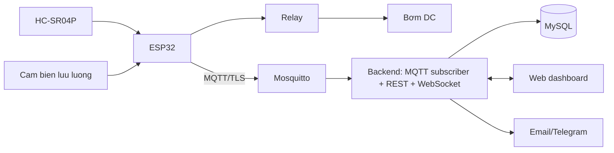
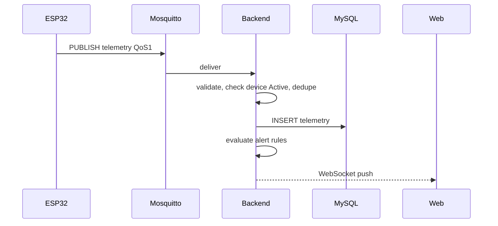
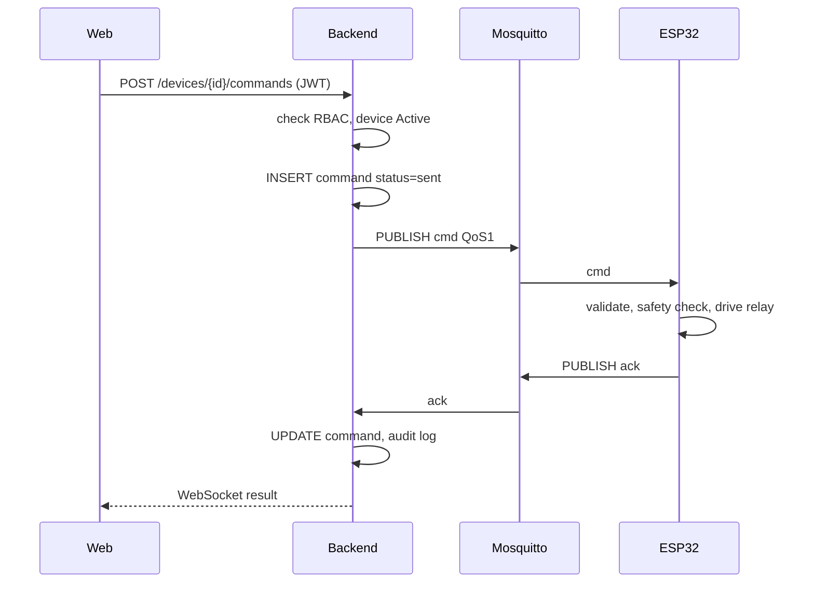
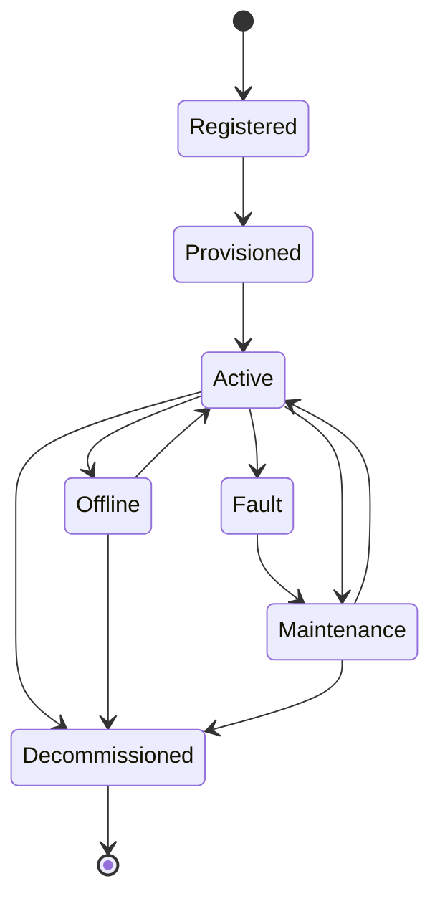
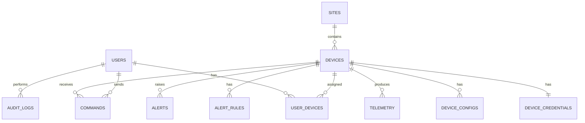

# Khung triển khai đồ án IoT – Hệ thống quản lý cấp nước thông minh

Nhóm 4 người · Học phần IoT và ứng dụng · Hạn nộp báo cáo + code (GitHub): 24/11/2026 · Demo và vấn đáp: 25/11 hoặc 02/12/2026 (lịch dự kiến, theo dõi thông báo của giảng viên)

## 0. Phạm vi đã chốt

- **Thiết bị:** 1 node ESP32 duy nhất, gồm cảm biến siêu âm HC-SR04P (đo mực nước), cảm biến lưu lượng YF-S401 (hoặc YF-S201) và module relay điều khiển bơm chìm mini DC. Không dùng LCD, LED, OLED, còi.
- **Phần mềm:** backend tự xây, web dashboard, MQTT (Mosquitto), CSDL quan hệ (MySQL), Docker Compose.
- **An toàn (mục 10 đề bài):** chỉ dùng điện DC thấp áp, không đấu 220V; không camera, mic, vị trí, dữ liệu sức khỏe.
- **Nguyên tắc ưu tiên:** làm xong toàn bộ phần bắt buộc (mục 1–13 của tài liệu này) trước mốc M3, phần nâng cao chỉ làm sau đó.

## 1. Chọn công nghệ (xếp từ khó tiếp cận → dễ tiếp cận)

### 1.1 Backend

| # | Lựa chọn | Điểm mạnh | Điểm khó |
| --- | --- | --- | --- |
| 1 | Spring Boot (Java) + Spring Security + MySQL | Bảo mật, JWT, RBAC chuẩn và chặt chẽ | Nhiều boilerplate, cấu hình dài; MQTT qua Eclipse Paho hoặc Spring Integration |
| 2 | Node.js (Express hoặc NestJS) + MySQL + mqtt.js | Cùng ngôn ngữ JS với frontend, MQTT và WebSocket dễ | Phải tự dựng cấu trúc thư mục, middleware phân quyền |
| 3 | Python FastAPI + SQLAlchemy + paho-mqtt | Ít code nhất, tự sinh tài liệu API (/docs), dễ nhất | Cần chạy MQTT subscriber song song với API (thread hoặc background task) |

### 1.2 Frontend

| # | Lựa chọn | Điểm mạnh | Điểm khó |
| --- | --- | --- | --- |
| 1 | React + Vite + TypeScript + Recharts | Hệ sinh thái lớn, giao diện đẹp | Nhiều khái niệm (state, hook, router) |
| 2 | Vue 3 + Vite + Chart.js | Template giống HTML, dễ hơn React | Vẫn cần build tool và học component |
| 3 | HTML + Alpine.js + Chart.js (không build) | Dễ nhất, chỉ cần mở file là chạy | Khó quản lý khi nhiều trang; với 8–9 trang vẫn đủ |

### 1.3 Cách chọn

- Chọn stack mà **ít nhất 2 người trong nhóm review được code của nhau**, vì vấn đáp đánh giá từng cá nhân.
- Nhóm chưa có stack chung: gợi ý **FastAPI + Vue 3** (hoặc Alpine.js nếu muốn nhanh nhất).
- Dùng chung: MySQL 8, Eclipse Mosquitto 2, Docker Compose, Arduino IDE hoặc PlatformIO (thư viện PubSubClient, ArduinoJson, WiFiClientSecure), Git/GitHub.
- Ghi lý do chọn từng công nghệ vào báo cáo (đề bài yêu cầu giải thích, không chỉ liệt kê).

## 2. Danh sách sơ đồ bắt buộc và cách làm

Công cụ: draw.io (diagrams.net) hoặc mermaid.live. Xuất PNG/SVG vào `docs/diagrams/` rồi chèn vào báo cáo.

| # | Sơ đồ | Nội dung cần có | Phụ trách |
| --- | --- | --- | --- |
| 1 | Bối cảnh hệ thống | Hệ thống ở giữa; actor: Admin, Operator, Viewer, Thiết bị; kênh ngoài (email/Telegram) | TV4 |
| 2 | Use case | UC theo vai trò (xem mục 8) | TV4 |
| 3 | Kiến trúc tổng thể và các lớp | Thiết bị, kết nối, gateway/broker, backend, dữ liệu, ứng dụng (đối chiếu mô hình lớp ở Chapter 2) | TV2 |
| 4 | Khối phần cứng | ESP32, cảm biến siêu âm, cảm biến lưu lượng, relay, bơm, nguồn | TV1 |
| 5 | Đấu nối | Chân GPIO, nguồn 5V riêng cho bơm (vẽ bằng Fritzing hoặc draw.io) | TV1 |
| 6 | Triển khai | 4 container: mosquitto, backend, mysql, frontend (nginx); mạng và cổng | TV3 |
| 7 | ERD | Xem mục 6.2 | TV2 |
| 8 | Sequence (làm 2, nên làm 3) | Telemetry → dashboard; lệnh bơm + ack; (thêm) onboarding thiết bị | TV2, TV3 |
| 9 | Trạng thái vòng đời thiết bị | Xem mục 5 | TV2 |
| 10 | Ma trận vai trò và quyền | Xem mục 8 | TV3 |
| 11 | Mô hình mối đe dọa | Xem mục 9 | TV3 |

Mã Mermaid để dán vào mermaid.live:

**Kiến trúc tổng thể**



**Sequence: telemetry → dashboard**



**Sequence: lệnh bơm có xác nhận**



**Vòng đời thiết bị**



## 3. Phần cứng và firmware (TV1)

### 3.1 Đấu nối

| Linh kiện | Chân ESP32 | Ghi chú |
| --- | --- | --- |
| HC-SR04P Trig | GPIO5 | Dùng loại 3.3V–5V; nếu dùng HC-SR04 thường, chia áp chân Echo |
| HC-SR04P Echo | GPIO18 |  |
| Cảm biến lưu lượng (chân tín hiệu) | GPIO27 | Đếm xung bằng ngắt ngoài, dùng INPUT\_PULLUP; thử mức tín hiệu trước khi nối cố định |
| Relay IN | GPIO26 | Module có opto; kiểm tra mức kích (thường active-low) |
| Bơm | Qua relay | Nguồn 5V riêng cho bơm (pin sạc dự phòng), chung GND với ESP32 |

Đặt ESP32 và relay trong hộp, tránh xa nước. Cảm biến siêu âm gắn nắp bồn, hướng thẳng xuống mặt nước. Cảm biến lưu lượng gắn nối tiếp trên ống ngay sau đầu ra bơm, đúng chiều mũi tên trên thân. Hệ thống chỉ có 1 thiết bị với 1 deviceId.

### 3.2 Cách làm firmware (làm lần lượt)

1. Đọc cảm biến siêu âm: lấy 5 mẫu, lấy trung vị để lọc nhiễu; quy đổi `level_pct` theo `tank_height_cm` (cấu hình được). Đếm xung cảm biến lưu lượng bằng ngắt ngoài (GPIO27) và đổi ra lít/phút mỗi giây.
2. Kết nối Wi-Fi, đồng bộ giờ NTP (cần timestamp chuẩn để đo độ trễ).
3. Kết nối MQTT bằng username = `deviceId`, mật khẩu riêng; đặt **Last Will** trên topic `status` (payload offline, retained).
4. Khi kết nối thành công: publish `status` online (retained) kèm `fw_version`; subscribe `cmd` và `config`.
5. Vòng lặp: publish `telemetry` mỗi N giây (N lấy từ config), publish heartbeat `status` mỗi 30 giây.
6. Xử lý lệnh: kiểm tra `cmd_id` chưa xử lý, kiểm tra giới hạn an toàn, điều khiển relay, publish `ack`.
7. Mất mạng: lưu mẫu vào bộ đệm vòng (khoảng 100 mẫu), tự kết nối lại với backoff tăng dần; khi có mạng, gửi bù theo thứ tự `seq`.
8. Bảo vệ cục bộ (không phụ thuộc cloud): tự ngắt bơm khi lưu lượng bằng 0 quá dry\_run\_s giây (chạy khô), khi mực nước vượt ngưỡng đầy, hoặc khi bơm chạy liên tục quá `pump_max_run_s`.
9. Bật watchdog; publish `free_heap` trong heartbeat để đo độ ổn định.

## 4. Giao thức MQTT và luồng dữ liệu (TV2 chủ trì, TV1 đồng thiết kế)

### 4.1 Cấu trúc topic

Dùng `deviceId` làm username để ACL của broker viết một lần cho mọi thiết bị (khu vực/site lưu trong CSDL, không đưa vào topic). Thiết bị duy nhất có deviceId mẫu wms-001 và credential riêng.

| Topic | Hướng | QoS | Retained | Nội dung |
| --- | --- | --- | --- | --- |
| `wms/{deviceId}/telemetry` | thiết bị → server | 1 | không | Mực nước, lưu lượng, trạng thái bơm, lỗi (nếu có) |
| `wms/{deviceId}/status` | thiết bị → server | 1 | có | online/offline (LWT), heartbeat, fw\_version |
| `wms/{deviceId}/cmd` | server → thiết bị | 1 | không | Lệnh bơm |
| `wms/{deviceId}/ack` | thiết bị → server | 1 | không | Kết quả thực hiện lệnh |
| `wms/{deviceId}/config` | server → thiết bị | 1 | có | Cấu hình, thiết bị nhận lại sau khi reconnect |

### 4.2 Mẫu bản tin

Telemetry:

```json
{"device_id":"wms-001","boot_id":"a3f9","seq":1042,"ts":"2026-11-01T09:00:05Z","distance_cm":18.4,"level_pct":72.5,"flow_lpm":3.2,"flow_total_l":15.4,"pump_on":true,"fault":"","rssi":-61,"unit":{"distance":"cm","level":"%","flow":"L/min"}}
```

Lệnh (server → thiết bị):

```json
{"cmd_id":"7c1e-...","action":"pump","value":"on","duration_s":60,"issued_at":"2026-11-01T09:01:00Z"}
```

Ack (thiết bị → server):

```json
{"cmd_id":"7c1e-...","result":"ok","reason":null,"ts":"2026-11-01T09:01:01Z"}
```

Cấu hình: `{"version":3,"sample_interval_s":5,"tank_height_cm":25,"low_pct":20,"high_pct":90,"pump_max_run_s":120,"auto_mode":true,"dry_run_s":10}`

### 4.3 Quy tắc xử lý

- **Bản tin trùng:** backend loại theo khóa (`device_id`, `boot_id`, `seq`).
- **Lệnh:** có TTL 10 giây (lệnh cũ hơn bị bỏ qua), thiết bị nhớ vài `cmd_id` gần nhất để không chạy lại lệnh trùng, backend đặt timeout 5 giây nếu không có ack và ghi trạng thái `timeout`.
- **Online/offline:** nhận LWT hoặc mất heartbeat quá 90 giây thì đánh dấu offline và sinh cảnh báo.
- **Xác thực dữ liệu:** `level_pct` trong 0–100, `ts` không lệch quá ±5 phút, thiếu trường bắt buộc thì loại và ghi log.

## 5. Vòng đời thiết bị và cấp thông tin xác thực (TV2 + TV3)

| Trạng thái | Điều kiện chuyển | Tác động |
| --- | --- | --- |
| Registered | Admin tạo thiết bị trên web (mã, tên, phiên bản phần cứng) | Chưa có credential |
| Provisioned | Admin bấm cấp credential | Backend sinh `deviceId` và mật khẩu ngẫu nhiên, **hiển thị đúng 1 lần**, chỉ lưu bản băm; tạo tài khoản MQTT trên broker |
| Active | Thiết bị kết nối lần đầu hoặc Admin kích hoạt | Nhận dữ liệu, cho phép lệnh |
| Offline | Mất heartbeat | Cảnh báo, chặn lệnh bơm |
| Fault | Lỗi cảm biến (đọc ngoài dải) hoặc bơm không làm tăng mực nước | Cảnh báo, ngắt bơm |
| Maintenance (tạm khóa) | Admin/Operator chuyển | Ngắt kết nối, không nhận dữ liệu |
| Decommissioned (thu hồi) | Admin xác nhận | Xóa credential trên broker, không thể quay lại |

**Cách làm khóa/thu hồi (cần chứng minh được khi demo):**

- **Cách 1 (khuyến nghị):** dùng plugin Dynamic Security của Mosquitto 2.x, backend tạo/xóa client bằng `mosquitto_ctrl` hoặc topic `$CONTROL/dynamic-security/v1`; xóa client sẽ ngắt kết nối ngay. Kiểm tra phiên bản Mosquitto và tài liệu của plugin trước khi dùng.
- **Cách 2 (đơn giản hơn):** dùng `password_file` và `acl_file`, backend cập nhật file rồi khởi động lại container broker. Với 1 thiết bị thì chấp nhận được.
- **Lớp bảo vệ thứ hai (bắt buộc làm cả hai cách):** backend chỉ ghi dữ liệu của thiết bị đang ở trạng thái Active.

File ACL dùng mẫu theo username: `pattern write wms/%u/telemetry`, `pattern write wms/%u/status`, `pattern write wms/%u/ack`, `pattern read wms/%u/cmd`, `pattern read wms/%u/config`. Tài khoản `backend` được đọc/ghi `wms/#`.

## 6. Backend, CSDL và quy tắc cảnh báo (TV2)

### 6.1 Module backend

auth · user · device (lifecycle, credential) · telemetry ingest (MQTT subscriber) · telemetry query · command · alert engine · config · audit log · WebSocket gateway.

### 6.2 ERD



| Bảng | Cột chính |
| --- | --- |
| users | id, email (unique), password\_hash, full\_name, role, status, created\_at |
| sites | id, name, description |
| devices | id, device\_code (unique), name, site\_id, state, hw\_version, fw\_version, online, last\_seen, created\_at |
| device\_credentials | device\_id, mqtt\_username, secret\_hash, revoked\_at |
| user\_devices | user\_id, device\_id (gán phạm vi truy cập) |
| device\_configs | device\_id, key, value, version, updated\_by, updated\_at |
| telemetry | id, device\_id, boot\_id, seq, ts, distance\_cm, level\_pct, flow\_lpm, flow\_total\_l, pump\_on, fault, rssi; unique (device\_id, boot\_id, seq); index (device\_id, ts) |
| alert\_rules | id, device\_id, type, params\_json, severity, enabled |
| alerts | id, device\_id, rule\_id, type, severity, value, state (open/ack/closed), opened\_at, acked\_by, acked\_at, closed\_at |
| commands | id, cmd\_id (unique), device\_id, user\_id, action, params\_json, status (sent/ok/fail/timeout), sent\_at, acked\_at, reason |
| audit\_logs | id, user\_id, action, target\_type, target\_id, ip, detail, created\_at |

### 6.3 Quy tắc cảnh báo (đối chiếu Chapter 5: hysteresis, min-duration, cooldown, ack)

| Quy tắc | Điều kiện sinh | Điều kiện đóng | Hành động |
| --- | --- | --- | --- |
| LOW\_LEVEL | `level_pct` < `low_pct` liên tục ≥ 10 giây | > `low_pct` + 5 | Cảnh báo; nếu `auto_mode` thì gửi lệnh bật bơm |
| HIGH\_LEVEL | `level_pct` > `high_pct` | < `high_pct` − 5 | Ngắt bơm |
| LEAK\_SUSPECT | Bơm tắt và mực nước giảm quá r cm/phút trong N phút (so trung vị đầu/cuối cửa sổ trượt) | Mực ổn định | Cảnh báo nghi rò rỉ |
| PUMP\_NO\_FLOW | Bơm bật quá T giây mà lưu lượng bằng 0 (chạy khô), hoặc mực nước không tăng ≥ x% | Admin xử lý | Ngắt bơm, thiết bị chuyển Fault |
| DEVICE\_OFFLINE | Mất heartbeat > 90 giây | Có heartbeat lại | Cảnh báo |

Mỗi quy tắc có cooldown 5 phút để tránh alert storm. Gửi thông báo qua email hoặc Telegram bot là tùy chọn (chọn một kênh, làm sau mốc M3).

**Demo rò rỉ:** mở van tay hoặc tháo kẹp ống ở thành bồn nhận để mực nước giảm trong khi bơm tắt.

### 6.4 Xử lý telemetry (thứ tự trong code)

nhận bản tin → parse JSON → kiểm tra schema và dải giá trị → kiểm tra thiết bị Active → loại trùng → lưu → cập nhật `last_seen` → đánh giá quy tắc → đẩy WebSocket.

## 7. Mô tả API (TV2 viết, TV4 dùng mock trước)

Tất cả API (trừ login) yêu cầu JWT; quyền kiểm tra ở backend. Lỗi: 401 chưa/ sai token, 403 không đủ quyền, 404 không thấy hoặc ngoài phạm vi, 422 dữ liệu sai.

| Nhóm | Phương thức và đường dẫn | Quyền |
| --- | --- | --- |
| Auth | POST /api/auth/login · POST /api/auth/logout · POST /api/auth/change-password · GET /api/me | Mọi vai trò |
| Người dùng | GET, POST /api/users · PATCH /api/users/{id} (role, status) | Admin |
| Thiết bị | GET /api/devices · POST /api/devices · GET /api/devices/{id} | Theo phạm vi |
| Vòng đời | POST /api/devices/{id}/provision · PATCH /api/devices/{id}/state | Admin (Operator: Maintenance thiết bị của mình) |
| Cấu hình | GET, PUT /api/devices/{id}/config | Operator, Admin |
| Dữ liệu | GET /api/devices/{id}/telemetry?from=&to=&interval= · GET .../telemetry/latest · GET .../telemetry/export | Theo phạm vi |
| Lệnh | POST /api/devices/{id}/commands · GET /api/devices/{id}/commands | Operator, Admin |
| Cảnh báo | GET /api/alerts?state= · POST /api/alerts/{id}/ack · POST /api/alerts/{id}/close · GET, PUT /api/devices/{id}/alert-rules | Xem: mọi vai trò; xử lý: Operator, Admin |
| Audit | GET /api/audit-logs | Admin |
| Realtime | WS /ws (xác thực bằng JWT): sự kiện `telemetry`, `alert`, `device_state`, `command_result` | Theo phạm vi |

Băm mật khẩu bằng bcrypt hoặc argon2; JWT có thời hạn ngắn; giới hạn đăng nhập sai (khóa tạm sau 5 lần).

## 8. Ma trận vai trò và quyền (TV3)

Ký hiệu: ✔ được phép · ✖ không · ◐ chỉ với thiết bị được gán/thuộc quyền.

| Chức năng | Admin | Operator | Viewer |
| --- | --- | --- | --- |
| Quản lý người dùng (tạo, khóa, đổi vai trò) | ✔ | ✖ | ✖ |
| Xem và sửa thông tin tài khoản của mình, đổi mật khẩu | ✔ | ✔ | ✔ |
| Đăng ký, cấp credential, thu hồi thiết bị | ✔ | ✖ | ✖ |
| Gán thiết bị cho người dùng và khu vực | ✔ | ✖ | ✖ |
| Xem danh sách và trạng thái thiết bị | ✔ | ◐ | ◐ |
| Xem dữ liệu hiện tại, lịch sử, biểu đồ | ✔ | ◐ | ◐ |
| Xuất dữ liệu CSV | ✔ | ◐ | ✖ |
| Đổi cấu hình và ngưỡng cảnh báo | ✔ | ◐ | ✖ |
| Gửi lệnh bật/tắt bơm | ✔ | ◐ | ✖ |
| Chuyển thiết bị sang Maintenance | ✔ | ◐ | ✖ |
| Xem cảnh báo | ✔ | ◐ | ◐ |
| Xác nhận (ack) và đóng cảnh báo | ✔ | ◐ | ✖ |
| Xem audit log | ✔ | ✖ | ✖ |

Cách làm: lưu `role` trong bảng `users`; viết một hàm kiểm quyền dùng chung (role + quan hệ `user_devices`) và gọi ở **mọi** endpoint (middleware, dependency hoặc annotation tùy stack). Frontend chỉ ẩn nút cho tiện; backend mới là nơi chặn.

## 9. Bảo mật, quyền riêng tư và mô hình mối đe dọa (TV3)

### 9.1 Mô hình mối đe dọa

| Mối đe dọa | Biện pháp kiểm soát | Kiểm thử |
| --- | --- | --- |
| Giả mạo dữ liệu cảm biến (false data injection) | Credential riêng từng thiết bị, ACL theo topic, kiểm tra khoảng giá trị và biến thiên bất thường giữa 2 mẫu | S4, S5 |
| Giả mạo hoặc lặp lại lệnh bơm (replay) | Lệnh chỉ đi qua backend có JWT + RBAC, `cmd_id` duy nhất, TTL 10 giây, thiết bị kiểm tra giới hạn an toàn | S1, S2 |
| Lộ credential | Secret để trong `.env`, không commit; chỉ lưu bản băm; secret thiết bị hiển thị 1 lần; quét secret bằng gitleaks | Kiểm tra repo |
| Dò mật khẩu | bcrypt/argon2, khóa tạm sau 5 lần sai, rate limit | S6 |
| SQL injection, XSS | ORM hoặc câu lệnh tham số hóa, escape khi hiển thị, validate input | S5 |
| Nghe lén đường truyền | TLS cho MQTT (cổng 8883) và HTTPS cho web nếu nền tảng cho phép | Bắt gói bằng Wireshark |
| Thiết bị bị thu hồi vẫn kết nối | Xóa tài khoản broker và chặn ở backend theo trạng thái | S3 |
| Tràn bản tin (DoS) | Giới hạn tần suất theo thiết bị ở backend, giới hạn kích thước payload | Script gửi dồn |

### 9.2 Kiểm thử bảo mật (đề bài yêu cầu ít nhất 2; nên làm cả 6)

| Mã | Kịch bản | Kỳ vọng | Bằng chứng |
| --- | --- | --- | --- |
| S1 | Operator A gọi API xem/điều khiển thiết bị của B | 403 hoặc 404 | Ảnh chụp curl/Postman |
| S2 | Gọi API với token sai hoặc hết hạn | 401 | Ảnh chụp |
| S3 | Thu hồi thiết bị rồi cho nó kết nối/publish lại | Broker từ chối, backend không ghi dữ liệu | Log broker + DB |
| S4 | Dùng credential của thiết bị publish vào topic không được phép | Bị từ chối (ACL) | Log `mosquitto_pub` |
| S5 | Gửi dữ liệu sai (`level_pct` = 999, thiếu `ts`, chuỗi script) | Bị loại, có log, không lưu | Log backend |
| S6 | Đăng nhập sai nhiều lần | Bị khóa tạm | Ảnh chụp |

### 9.3 Quyền riêng tư (viết vào báo cáo)

- Dữ liệu cá nhân thu thập: email, họ tên, địa chỉ IP trong audit log. Không thu vị trí, hình ảnh, âm thanh, dữ liệu sức khỏe.
- Biện pháp: băm mật khẩu, phân quyền theo phạm vi, audit log, chính sách lưu trữ telemetry (ví dụ 90 ngày), dữ liệu mẫu không dùng thông tin thật.

### 9.4 Quy tắc bắt buộc về repo

Không commit mật khẩu, token, khóa API, chứng thư và khóa riêng; chỉ commit `.env.example`. Thêm `.gitignore` cho `.env`, `*.pem`, `*.key`. Chứng thư TLS sinh bằng script trong `deployment/`, không đưa khóa riêng lên GitHub.

## 10. Giao diện web (TV4)

| Trang | Nội dung | Vai trò thấy |
| --- | --- | --- |
| Đăng nhập | Form, thông báo lỗi, đăng xuất | Tất cả |
| Dashboard | Thẻ mực nước (%), thẻ lưu lượng (L/phút và tổng lít), trạng thái bơm, badge online/offline, thời điểm cập nhật cuối, mức nghiêm trọng (normal/warning/critical/offline), biểu đồ mực nước và lưu lượng 1 giờ/24 giờ/7 ngày, cảnh báo dữ liệu cũ khi quá 2 chu kỳ không có mẫu mới | Tất cả (theo phạm vi) |
| Danh sách thiết bị | Bảng, lọc theo trạng thái vòng đời, tìm kiếm | Tất cả (theo phạm vi) |
| Chi tiết thiết bị | Thông tin, trạng thái vòng đời, firmware, form cấu hình, nút bơm kèm trạng thái lệnh gần nhất, tab lịch sử lệnh và lịch sử dữ liệu (bảng + biểu đồ + xuất CSV) | Theo quyền |
| Cảnh báo | Lọc open/ack/closed, nút xác nhận và đóng | Theo quyền |
| Người dùng | Tạo, khóa, đổi vai trò, gán thiết bị | Admin |
| Audit log | Bảng có lọc theo người dùng và thời gian | Admin |
| Tài khoản | Đổi mật khẩu, cập nhật thông tin | Tất cả |

Cách làm: thống nhất file mô tả API (OpenAPI hoặc bảng ở mục 7) rồi dùng dữ liệu giả (mock JSON) để làm giao diện song song với backend; kết nối WebSocket để cập nhật dashboard theo thời gian thực; mọi lệnh bơm phải hiển thị rõ các trạng thái gửi → chờ → thành công/thất bại/timeout.

## 11. Kế hoạch kiểm thử (TV1 chủ trì chạy, mỗi người chịu phần mình)

### 11.1 Kiểm thử chức năng (8 quy trình bắt buộc)

| Mã | Quy trình | Kỳ vọng | Bằng chứng |
| --- | --- | --- | --- |
| F1 | Đăng nhập và phân quyền theo 3 vai trò | Mỗi vai trò chỉ thấy chức năng được phép | Ảnh chụp màn hình |
| F2 | Đăng ký, cấp credential, kích hoạt thiết bị | Trạng thái đi đúng Registered → Provisioned → Active | Ảnh + bảng `devices` |
| F3 | Thiết bị gửi telemetry | Có bản ghi trong CSDL với `ts` và `seq` đúng | Log + truy vấn DB |
| F4 | Dashboard cập nhật dữ liệu | Số liệu đổi theo mực nước thật | Video ngắn |
| F5 | Gửi lệnh bơm và nhận xác nhận | Bơm chạy, `commands.status` = ok | Video + log |
| F6 | Phát hiện thiết bị offline | Rút nguồn thiết bị, hệ thống báo offline | Ảnh + log |
| F7 | Sinh và xử lý cảnh báo | Làm cạn nước, cảnh báo xuất hiện, ack được | Ảnh |
| F8 | Khóa và thu hồi thiết bị | Thiết bị không kết nối lại được | Log broker |

### 11.2 Kiểm thử phi chức năng (mỗi chỉ tiêu cần phương pháp, số liệu, nhận xét)

| Chỉ tiêu | Phương pháp đo | Số liệu báo cáo |
| --- | --- | --- |
| Độ trễ cảm biến → dashboard | Thiết bị gắn `ts` (NTP), backend ghi thời điểm nhận và thời điểm đẩy WebSocket; đo ≥ 100 mẫu | Trung bình, p95 |
| Độ trễ lệnh điều khiển | Từ lúc bấm nút đến lúc nhận ack; ≥ 30 lần | Trung bình, lớn nhất |
| Tỷ lệ mất bản tin | Đếm khoảng hở của `seq` trong 1 giờ (720 mẫu ở chu kỳ 5 giây); so QoS 0 với QoS 1 | % mất |
| Phục hồi sau mất mạng | Tắt Wi-Fi 2 phút rồi bật lại | Thời gian reconnect, số mẫu đồng bộ bù |
| Bản tin trùng | Publish lại cùng (`boot_id`, `seq`) | Chỉ 1 bản ghi được lưu |
| CPU và bộ nhớ | `docker stats` cho backend; `free_heap` của ESP32 trong heartbeat | Giá trị trung bình và nhỏ nhất |
| Độ ổn định | Chạy liên tục 24 giờ | Số lần reconnect, lỗi, heap nhỏ nhất |
| Quy mô (tùy chọn) | Script mô phỏng 50–100 thiết bị ảo publish đồng thời | Số bản tin/giây xử lý được |

Thiết bị mô phỏng chỉ dùng cho đo quy mô, không thay thế thiết bị vật lý. Lưu script và kết quả đo vào `tests/`.

## 12. Cấu trúc repo và quy ước làm việc (TV3 dựng, cả nhóm tuân thủ)

Cấu trúc bắt buộc:

```
README.md
firmware/
backend/
frontend/
database/
deployment/
hardware/
tests/
docs/
.env.example
```

- `README.md`: giới thiệu, kiến trúc, hướng dẫn cài và chạy bằng một lệnh `docker compose up`.
- `database/`: schema, migration, dữ liệu mẫu. `deployment/`: Docker Compose, cấu hình Mosquitto, script sinh chứng thư. `hardware/`: sơ đồ nối dây, danh sách linh kiện, ảnh prototype. `tests/`: script và kịch bản kiểm thử. `docs/`: báo cáo, slide, sơ đồ.
- Mỗi thành viên dùng tài khoản GitHub riêng; nhánh `main` được bảo vệ, làm việc trên nhánh `feat/...`, gộp bằng Pull Request có ít nhất 1 người review.
- Commit rõ nghĩa, ví dụ `feat(backend): thêm API gửi lệnh bơm`. Dùng GitHub Projects hoặc Issues để theo dõi công việc.
- Cuối kỳ: tạo tag/release `v1.0.0`; nếu repo private thì cấp quyền cho giảng viên.
- Khai báo nguồn mã, thư viện và công cụ AI đã dùng (README hoặc báo cáo). Mọi thành viên phải hiểu và giải thích được phần mình.

## 13. Kịch bản demo (10 bước bắt buộc, phụ trách xen kẽ)

| Bước | Nội dung | Chuẩn bị |
| --- | --- | --- |
| 1 | Đăng nhập lần lượt Admin, Operator, Viewer | 3 tài khoản mẫu |
| 2 | Đăng ký và kích hoạt thiết bị | Thiết bị đã flash, chưa có credential |
| 3 | Thiết bị gửi mực nước và lưu lượng | Bồn có nước |
| 4 | Dashboard hiển thị thời gian thực | Đổi mực nước bằng tay |
| 5 | Gửi lệnh bơm và nhận phản hồi | Bơm đã nối relay |
| 6 | Thay đổi cấu hình (ngưỡng, chu kỳ) | Thiết bị nhận config mới |
| 7 | Rút nguồn để phát hiện offline | Heartbeat 30 giây, offline sau 90 giây (có thể rút ngắn khi demo) |
| 8 | Kích hoạt cảnh báo (cạn nước hoặc rò rỉ) | Van tay hoặc kẹp ống |
| 9 | Thử thao tác không có quyền (Viewer bấm bơm, hoặc Operator gọi thiết bị người khác) | Có sẵn lệnh curl |
| 10 | Khóa hoặc thu hồi thiết bị và chứng minh không kết nối lại được | Mở log broker |

Chuẩn bị video demo dự phòng (không thay thế demo trực tiếp). Phân bổ thời gian: thuyết trình 10 phút, demo 5–7 phút, vấn đáp 5 phút.

## 14. Báo cáo (20–30 trang) và slide (8–12 slide)

### 14.1 Khung báo cáo, người chịu trách nhiệm viết

| Mục | Nội dung | Số trang gợi ý | Người viết |
| --- | --- | --- | --- |
| 1–3 | Bìa, thông tin nhóm và bảng phân công, tóm tắt | 1,5 | TV4 |
| 4–5 | Giới thiệu bài toán, khảo sát yêu cầu (chức năng, phi chức năng, ràng buộc, tiêu chí thành công, vì sao cần IoT) | 3 | TV4 |
| 6 | Phân tích và lựa chọn giải pháp (giải thích từng lựa chọn công nghệ) | 2 | Cả nhóm, TV2 tổng hợp |
| 7 | Kiến trúc hệ thống (các sơ đồ mục 2) | 2 | TV2 |
| 8 | Thiết kế phần cứng | 2 | TV1 |
| 9 | Giao thức và luồng dữ liệu | 2,5 | TV1 |
| 10 | CSDL, API, backend | 3 | TV2 |
| 11 | Quản lý vòng đời thiết bị | 1,5 | TV2 |
| 12 | Người dùng và phân quyền | 1,5 | TV3 |
| 13 | Bảo mật và quyền riêng tư (threat model) | 2 | TV3 |
| 14 | Triển khai (Docker, hướng dẫn chạy) | 1,5 | TV3 |
| 15 | Kiểm thử và đánh giá (F1–F8, S1–S6, chỉ tiêu phi chức năng) | 4 | TV1 tổng hợp, mỗi người nộp phần mình |
| 16 | Chức năng nâng cao (nếu có) | 1 | Người làm phần đó |
| 17–20 | Hạn chế, hướng phát triển, kết luận, tài liệu tham khảo, phụ lục | 2 | TV4 |

Báo cáo phải có ảnh sản phẩm thực tế, sơ đồ kiến trúc, kết quả kiểm thử và đường dẫn GitHub.

### 14.2 Khung slide (tập trung quyết định thiết kế và kết quả, tránh lý thuyết chung)

1. Tên đề tài, thành viên. 2. Bài toán và đối tượng. 3. Yêu cầu và chức năng chính. 4. Kiến trúc tổng thể. 5. Thiết bị và sơ đồ phần cứng. 6. Giao thức và luồng dữ liệu. 7. Backend và vòng đời thiết bị. 8. Xác thực, phân quyền, bảo mật. 9. Kết quả triển khai và kiểm thử. 10. Chức năng nâng cao. 11. Phân công. 12. Kết luận.

## 15. Phân công cho 4 người (khối lượng tương đương)

| TV | Vai trò | Sản phẩm bàn giao | Phần báo cáo | Kiểm thử phụ trách |
| --- | --- | --- | --- | --- |
| TV1 | Thiết bị và kiểm thử | Lắp phần cứng và viết firmware (đọc cảm biến siêu âm và lưu lượng, MQTT, LWT, đệm offline, chống chạy khô, giới hạn thời gian chạy bơm), script mô phỏng và đo phi chức năng, thư mục `hardware/` và `tests/` | 8, 9, tổng hợp 15 | Đo độ trễ, mất bản tin, phục hồi mạng, ổn định, F3, F6 |
| TV2 | Backend lõi | MQTT ingest, CSDL, vòng đời thiết bị, lệnh + ack, alert engine, API, `database/` | 6, 7, 10, 11 | F2, F5, F7, bản tin trùng |
| TV3 | Bảo mật và triển khai | Auth, JWT, RBAC, audit log, cấu hình Mosquitto (TLS, ACL, thu hồi), Docker Compose, repo/CI, `deployment/` | 12, 13, 14 | F1, F8, S1–S6 |
| TV4 | Giao diện và tài liệu | Toàn bộ frontend, WebSocket client, hợp đồng API (OpenAPI), kịch bản demo, slide, ghép báo cáo | 1–5, 17–20 | F4, kiểm thử giao diện, diễn tập demo |

Nguyên tắc để mọi người đều bảo vệ được phần mình:

- Review chéo code theo cặp: TV1 ↔ TV2 (giao thức, bản tin), TV2 ↔ TV3 (backend, bảo mật), TV3 ↔ TV4 (xác thực, API), TV4 ↔ TV1 (demo end-to-end).
- Mỗi người tự trình bày 5 phút phần của mình cho cả nhóm nghe trước buổi vấn đáp.
- Nếu ai thiếu việc, chuyển sang người đó phần hợp đồng API, tài liệu hoặc chức năng nâng cao, tránh dồn thêm vào TV2.

## 16. Thứ tự làm và mốc thời gian (11/10/2026 đến 24/11/2026)

Quy tắc: **chốt hợp đồng giao tiếp trước** (topic, payload, API, ERD) rồi mới làm song song.

| Tuần | Công việc | Mốc kết thúc |
| --- | --- | --- |
| 0 (11–14/10) | Chốt stack. Đăng ký nhóm và đề tài qua link Google Sheet trong đề bài (điền đúng mã sinh viên). Tạo repo, GitHub Projects. Đặt mua thiết bị. Viết hợp đồng giao tiếp vào `docs/` (mục 4, 6.2, 7) | Hợp đồng được cả nhóm đồng ý |
| 1 (15–21/10) | Song song: TV1 lắp mạch, đọc cảm biến, Wi-Fi/MQTT. TV2 khung backend, DB, subscriber. TV3 Docker Compose, Mosquitto, khung auth. TV4 layout và trang đăng nhập với dữ liệu giả | **M1 (21/10):** thiết bị gửi telemetry lên broker, backend lưu vào DB |
| 2 (22–28/10) | Vòng đời thiết bị và credential, dashboard thời gian thực, lệnh bơm + ack, firmware xử lý lệnh | **M2 (28/10):** chạy được vòng kín cảm biến → backend → web → lệnh → bơm |
| 3 (29/10–4/11) | Quy tắc cảnh báo, phát hiện offline, RBAC đầy đủ, đệm dữ liệu khi mất mạng, trang quản lý user và audit. Chừa thời gian cho bài kiểm tra giữa kỳ (dự kiến 28/10 hoặc 4/11) | **M3 (4/11):** đủ chức năng bắt buộc, đóng băng tính năng |
| 4 (5–11/11) | TLS, ACL, thu hồi thiết bị, kiểm thử chức năng F1–F8, kiểm thử bảo mật S1–S6, đo phi chức năng, sửa lỗi | Bộ kết quả kiểm thử có bằng chứng |
| 5 (12–18/11) | Viết báo cáo, vẽ sơ đồ, làm slide, diễn tập demo, quay video dự phòng; làm chức năng nâng cao nếu M3 đạt | Báo cáo bản nháp, slide xong |
| 6 (19–24/11) | Đóng băng code, rà soát secret trong repo, README, tag `v1.0.0`, nộp báo cáo và link GitHub | **Nộp 24/11** |

Lịch thuyết trình (4/11, 11/11 hoặc 18/11) và demo/vấn đáp (25/11 hoặc 02/12) do giảng viên xếp, nên slide và video dự phòng cần xong từ tuần 5. Các ngày giữa kỳ và lịch trên là dự kiến, có thể thay đổi, cần theo dõi thông báo.

## 17. Chức năng nâng cao và danh sách tự kiểm tra

### 17.1 Nâng cao (chỉ làm sau M3, theo thứ tự ưu tiên)

1. Rule engine cho cảnh báo (cấu hình ngưỡng, thời gian tối thiểu từ giao diện).
2. Device shadow: lưu trạng thái mong muốn và trạng thái báo cáo của thiết bị.
3. Đồng bộ dữ liệu sau khi mất mạng (đã có đệm ở firmware, bổ sung đo đạc).
4. Docker hóa đầy đủ, thêm CI chạy test.
5. OTA hoặc AI chỉ làm khi còn dư thời gian và **phải demo trực tiếp được**. AI phải gắn với dữ liệu hệ thống (ví dụ phát hiện rò rỉ bất thường từ chuỗi mực nước) và trình bày dữ liệu, tiền xử lý, mô hình, chỉ số đánh giá, kết quả, cách tích hợp.

### 17.2 Tự kiểm tra để tránh mục 9 của đề bài

- [ ] Có thiết bị vật lý chạy thật (ESP32, cảm biến siêu âm và lưu lượng, relay/bơm).
- [ ] Backend tự xây, có quản lý người dùng và thiết bị (không dùng Blynk/ThingSpeak làm phần quản lý).
- [ ] Có xác thực và phân quyền, kiểm tra ở backend.
- [ ] Mã nguồn trên GitHub, chạy được theo README, có tag `v1.0.0`.
- [ ] Demo được luồng dữ liệu đầu cuối và đủ 10 bước.
- [ ] Mọi thành viên có phần việc riêng, tham gia vấn đáp, giải thích được code của mình.
- [ ] Trích dẫn nguồn, thư viện, công cụ AI; không sao chép khi chưa ghi nguồn.

### 17.3 Tự kiểm tra để tránh mục 10 (an toàn và đạo đức)

- [ ] Chỉ dùng bơm DC thấp áp qua relay, không đấu điện lưới 220V.
- [ ] Có giới hạn thời gian chạy bơm và chống chạy khô trong firmware.
- [ ] Không thu camera, mic, vị trí, dữ liệu sức khỏe; dữ liệu cá nhân có biện pháp bảo vệ.
- [ ] Công khai việc dùng mã nguồn, thư viện và công cụ AI của bên thứ ba.
